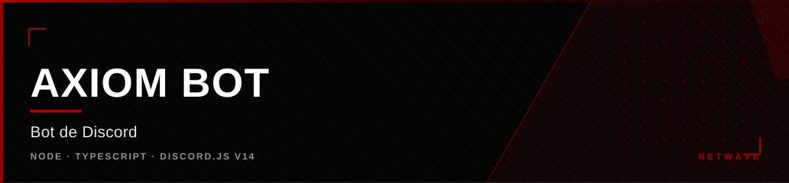

<div align="center">



</div>

<div align="center">

[](https://github.com/hiro0010/axiom-bot) [](https://github.com/hiro0010/axiom-bot) [](https://github.com/hiro0010/axiom-bot) [](https://github.com/hiro0010/axiom-bot)

</div>


## O que é

O bot oficial da Netwave no Discord. Centraliza os comandos da comunidade —
moderação, suporte, comunicação e informações dos projetos — em um único lugar,
com permissões por cargo e registros de auditoria.

**64 comandos**, **143 nomes e aliases**, carregados e validados.

---

## Como funciona

```
Mensagem → parser (parseMessage) → { command, args }
  → permissões → RBAC → cooldown → executa
```

O handler central em `src/index.ts` processa o `MessageCreate` nesta ordem:
blacklist → AFK → automod → parse → permissões → RBAC → cooldown → execução.

### Hierarquia de permissões

```
USER → STAFF → MODERATOR → ADMIN → OWNER
```

O nível OWNER é conferido contra o dono do servidor, separado do cargo do bot.

### Carregamento

O loader percorre `commands/{utils,mod,admin,support,communication,system,projects,updates}`
e resolve aliases. Arquivos iniciados com `_` são ignorados por serem
helpers internos.

---

## Stack

| Camada | Tecnologia |
|---|---|
| Runtime | Node.js |
| Linguagem | TypeScript |
| Biblioteca | discord.js v14 |
| Persistência | JSON em disco + MariaDB (LuckPerms, no servidor Minecraft) |
| Execução | serviço `node dist/index.js` |

---

## Recursos

| Categoria | Exemplos |
|---|---|
| **Moderação** | ban, kick, timeout, warn, clear, ticket, automod |
| **Suporte** | comandos de ajuda e FAQ |
| **Comunicação** | anúncios, bem-vindas, Reaction roles |
| **Projetos** | páginas de cada projeto da Netwave |
| **Sistema** | modlogs, configuração, blacklist |
| **Atualizações** | postagem de novidades e releases |

- **Modlogs** em arquivo + webhook opcional, com tipos para cada ação
- **Embeds centralizados** — todo embed tem footer `Yuna`
- **Cooldowns** por comando
- **Blacklist e AFK** no pipeline central

---

## Operação

O bot roda como serviço na VPS. Os modlogs registram ban, kick, timeout, warn,
clear, ticket, update, config, command, announce e automod.

Comandos de anúncio usam `allowed_mentions` limitado a cargos, para poder
mencionar @everyone com segurança.

---

## Status

Em produção. Bot ativo na comunidade, com comandos de moderação e
comunicação em uso diário.


<div align="center">

<sub>Parte da <a href="https://github.com/hiro0010/netwave">Netwave</a>
&middot; Owner: <a href="https://github.com/hiro0010">Hiro</a></sub>

</div>
